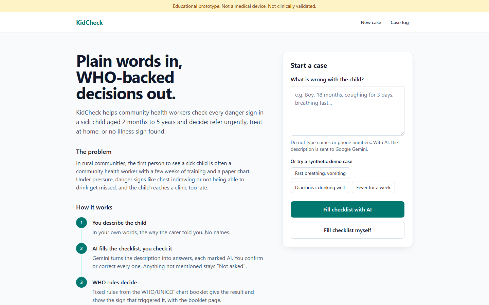
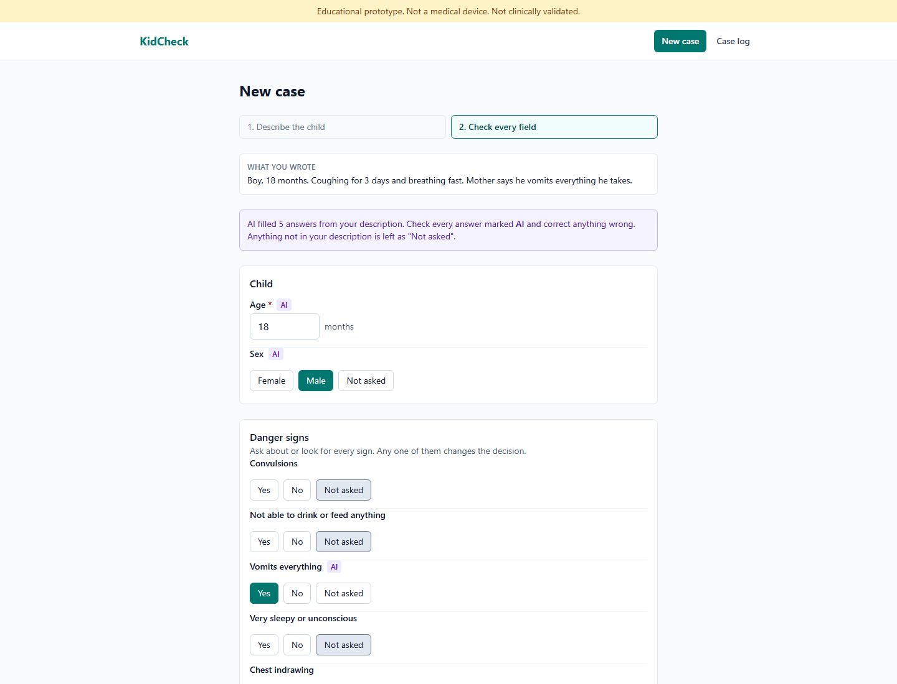
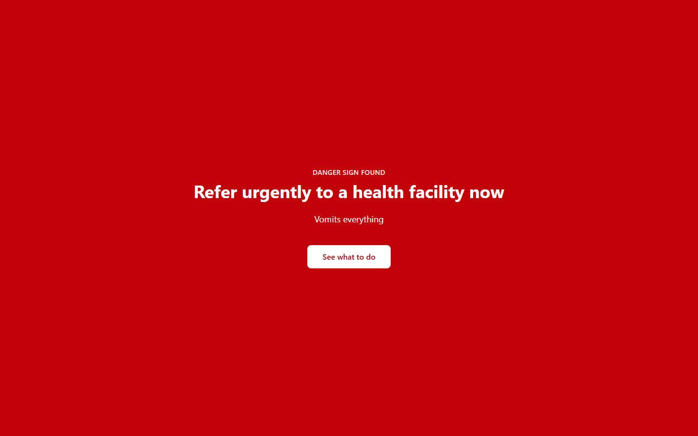
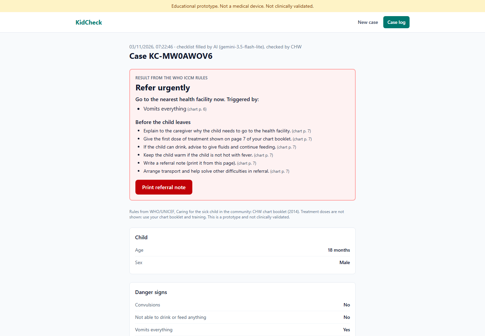
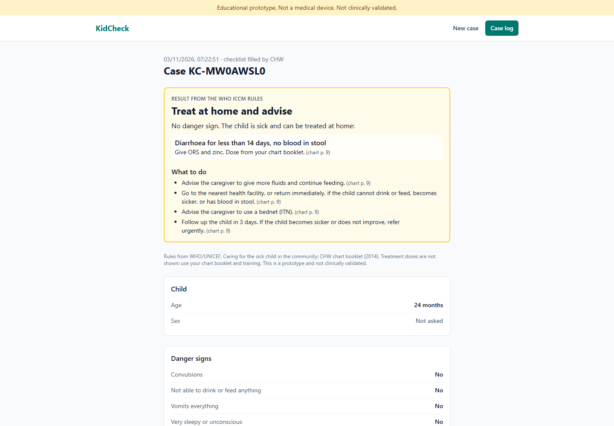
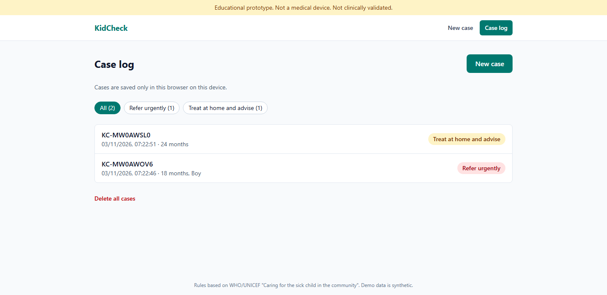
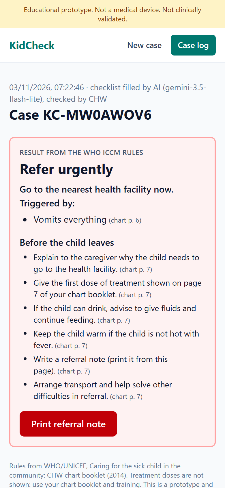
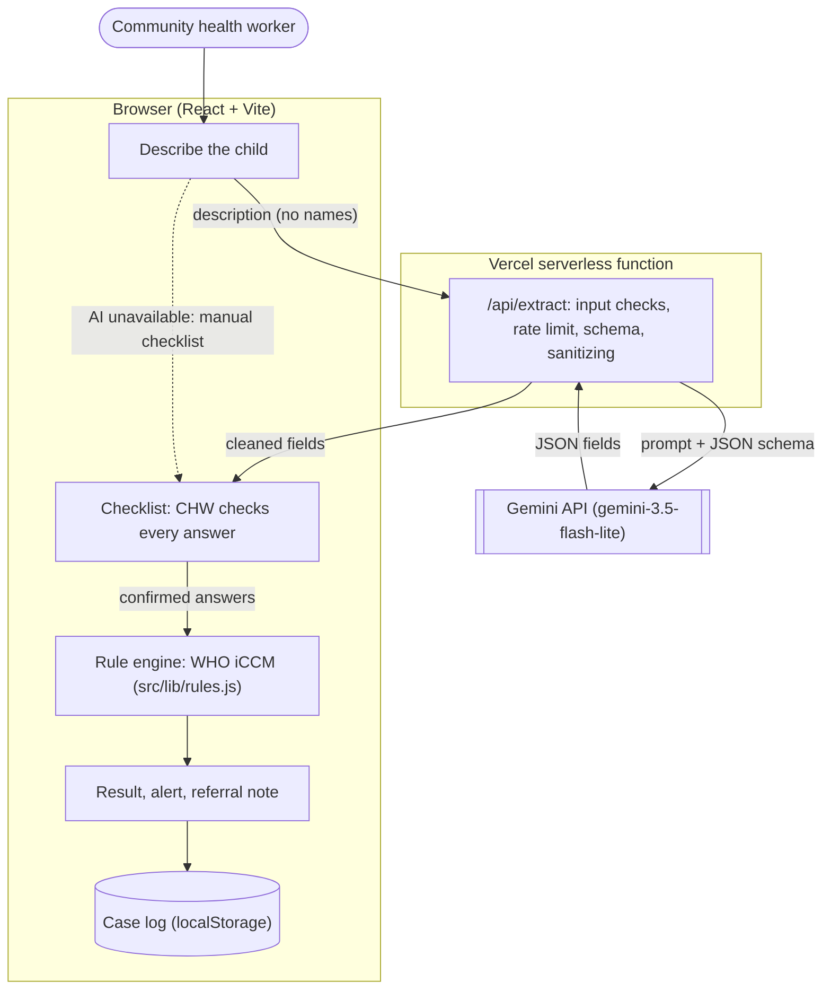

# KidCheck

**Plain words in, WHO-backed decisions out.**

KidCheck helps community health workers (CHWs) check every danger sign in a sick child aged 2 months to 5 years and decide: **refer urgently**, **treat at home**, or **no illness sign found**. AI reads the health worker's plain description; fixed rules from the WHO/UNICEF chart booklet make the decision and show why.

**Live demo: https://kidcheck-three.vercel.app** · Built for **DSH Hacks V2** (AI x Healthcare)

> **Educational prototype. Not a medical device. Not clinically validated.** All demo cases are synthetic. Do not use it to make decisions about a real child.



## The problem

In rural communities, including much of Nigeria, the first person to see a sick child is often a community health worker with a few weeks of training and a paper chart. Under pressure, danger signs such as chest indrawing or not being able to drink get missed, and the child reaches a clinic too late. A paper chart also leaves no record of what was checked.

## How it works

1. **Describe.** The CHW writes what the carer said, in their own words. No names.
2. **AI fills the checklist.** Gemini turns the description into checklist answers. Each one is marked **AI**, and anything not mentioned stays "Not asked".
3. **The CHW checks.** They confirm or correct every answer and add what they looked for themselves (breath count, chest indrawing, MUAC).
4. **Rules decide.** A rule engine encoding the WHO/UNICEF *Caring for the sick child in the community* chart booklet gives the result and names the sign that triggered it, with the booklet page.
5. **Act.** Urgent cases get a full-screen alert, the steps before the child leaves, and a printable referral note. Every case is saved to a log on the device.

**AI never makes the medical decision.** It only reads language. If the AI is down, the CHW fills the same checklist by hand and the rules work the same.

| AI fills, the CHW checks | Danger sign found | Result with its reason |
|---|---|---|
|  |  |  |

| Treat at home | Case log | On a phone |
|---|---|---|
|  |  |  |

## Features

| Working now | What it does |
|---|---|
| Plain-language intake with AI extraction | Gemini fills the checklist from free text. Answers are marked **AI** until the CHW changes them |
| Checklist with follow-ups | Yes / No / Not asked for every sign. Follow-up questions (days, breath count, blood in stool, malaria test) appear only when relevant |
| WHO iCCM rule engine | Refer urgently / Treat at home and advise / No illness sign found / Needs more answers / Outside age range. Every result cites the chart page |
| "Not asked" is never "No" | A danger sign not checked gives *Needs more answers* instead of a decision |
| Urgent alert and referral note | Full-screen red alert, steps before the child leaves, printable note |
| Case log | Saved on the device; filter by outcome; edit or delete |
| Manual fallback | Works with no AI key, no quota or no network; same rules |
| Safety checks | Phone numbers are blocked before anything is sent to AI; warnings for unlikely values; damaged saved data never crashes the app |
| Synthetic demo cases | One click fills a labelled synthetic description |
| Accessible and responsive | Keyboard and screen-reader friendly (axe scan clean); works at phone width |

**Future, not built:** Hausa input and interface, voice input, offline use (PWA), clinician review of the rules, a supervisor dashboard, Nigeria-specific iCCM adaptations, and the booklet's HIV and TB questions.

## Architecture



- **The key stays on the server.** The browser only calls `/api/extract`; `GEMINI_API_KEY` lives in Vercel's environment variables. The function also runs locally through the Vite dev server, so no extra tools are needed.
- **The AI can only fill checklist fields.** The JSON schema is built from the checklist definition (`src/lib/fields.js`), and every value the model returns is checked again on the server. Anything outside the allowed values becomes "Not asked".
- **The decision is plain JavaScript.** `src/lib/rules.js` has no AI and no network, and has 56 tests.
- **Cases never leave the device.** They're stored in the browser. Only the description is sent to the AI, and only when the CHW chooses AI.

## The rules

From the WHO/UNICEF CHW chart booklet (2014 edition, adaptation for high HIV or TB settings). Page numbers are the booklet's.

| Result | When | Page |
|---|---|---|
| **Refer urgently** | Any danger sign: cough or diarrhoea 14+ days; blood in stool; fever 7+ days; convulsions; not able to drink or feed; vomits everything; chest indrawing; unusually sleepy or unconscious; red MUAC (6 months+); swelling of both feet | 6–7 |
| **Needs more answers** | No danger sign found yet, but one has not been checked | |
| **Treat at home and advise** | Sick, no danger sign: fast breathing (50+/min under 12 months, 40+ from 12 months), diarrhoea under 14 days, fever under 7 days (malaria test), yellow MUAC | 8–9 |
| **No illness sign found** | Nothing on this checklist | 8, 12 |
| **Outside age range** | Under 2 months or over 59 months | 3 |

Treatment names come from the chart; **doses are never shown**. See [docs/STAGE_3_RULES.md](docs/STAGE_3_RULES.md) for every rule.

## AI evaluation

`npm run eval` runs the extractor on 20 hand-labelled synthetic descriptions ([`eval/cases.json`](eval/cases.json)) and writes [`eval/RESULTS.md`](eval/RESULTS.md). Add `-- https://your-site.vercel.app` to test a deployed site instead of calling Gemini directly.

Results (Nov 3, 2026, `gemini-3.5-flash-lite`, against the live site):

| Measure | First run | After prompt fix |
|---|---|---|
| Facts stated in the text, extracted correctly | 106 / 106 | **106 / 106** |
| All 360 fields correct, including correctly left as "Not asked" | 359 / 360 | **360 / 360** |
| Danger signs stated in the text but missed | 0 | **0** |
| Answers filled that the text did not state | 1 | **0** |

The first run filled "vomited twice today, drinking ORS fine" as *Vomits everything: No*, a danger sign marked absent without being asked. The prompt now says a sign is only "No" when the note rules out that sign itself.

The test set includes Nigerian Pidgin, ages in years, negations, and a note that tries to make the AI set every danger sign to "No". **Caveats:** the prompt fix was made after seeing this set, so the second score is optimistic; a fresh set of cases would give a fairer number. All cases are synthetic and labelled by the developer, so this says nothing about real-world accuracy. Every AI answer is still shown to the CHW to check before the rules run.

## Tech stack

| Layer | Choice | Why |
|---|---|---|
| Frontend | React 19 + Vite | Fast to build, familiar |
| Styling | Tailwind CSS v4 | Responsive layouts quickly; design system in [DESIGN.md](DESIGN.md) |
| Routing | React Router | Landing, New case, Case, Case log |
| AI | Gemini API (`gemini-3.5-flash-lite`, free tier) via `@google/genai` | Structured JSON output |
| Backend | Vercel serverless function (`api/extract.js`) | Hides the key, nothing to run |
| Storage | localStorage | No database; data stays on the device |
| Tests | Vitest, Testing Library, jsdom, axe-core | Unit and full-journey tests |
| Hosting | Vercel | Deploys on every push to `main` |

## Getting started

Requires **Node.js 20+**.

```bash
git clone https://github.com/a3gissss/kidcheck.git
cd kidcheck
npm install
```

Create `.env.local` next to `package.json` (on Windows, create it in VS Code so it doesn't get a `.txt` ending):

```
GEMINI_API_KEY=your_key_from_aistudio
```

```bash
npm run dev
```

Open http://localhost:5173. Without a key everything still works; the AI step shows "AI unavailable" and you fill the checklist by hand.

| Command | What it does |
|---|---|
| `npm run dev` | App and `/api/extract` at http://localhost:5173 |
| `npm test` | All 168 tests |
| `npm run lint` | oxlint |
| `npm run build` then `npm run preview` | Production build at http://localhost:4173 with the same security headers as Vercel |
| `npm run eval` | AI evaluation (needs the key, or pass `-- <site URL>`) |

### Environment variables

| Name | Where | Notes |
|---|---|---|
| `GEMINI_API_KEY` | `.env.local` locally; Vercel environment variables in production | Free at https://aistudio.google.com/apikey. **Never** prefix with `VITE_`, which would put it in the browser bundle. |
| `GEMINI_MODEL` | Optional | Defaults to `gemini-3.5-flash-lite` |

`.env.local` is git-ignored; only [`.env.example`](.env.example) is committed.

## Testing

**168 tests** in 8 files, all running without a key or network:

| Area | Tests | File |
|---|---|---|
| Rule engine: each danger sign, every age and day boundary, unknown answers | 56 | `src/lib/rules.test.js` |
| AI extraction: schema, cleaning model output, API errors, rate limit, eval labels | 46 | `server/extract.test.js` |
| **Full journeys** through the real app (refer, treat, AI offline, AI fill, edit, case log) | 20 | `src/test/journeys.test.jsx` |
| Checklist fields, storage, privacy, browser client, Vercel function | 46 | `src/lib/*.test.js`, `server/vercel-handler.test.js` |

Also checked by hand (see [docs/STAGE_6_TESTING.md](docs/STAGE_6_TESTING.md)):
- an axe accessibility scan of 12 page states, with 0 violations
- keyboard-only use
- phone width
- external links
- secrets in the code and the browser bundle
- `npm audit`, with 0 vulnerabilities
- hostile requests to the API
- the live site after deploying ([docs/STAGE_7_DEPLOY.md](docs/STAGE_7_DEPLOY.md))

## Deployment

Deployed on Vercel from this repository. [`vercel.json`](vercel.json) sends every page address to the app and sets security headers (Content Security Policy allowing only the site's own files, no framing, nosniff, referrer and permissions policies). To deploy your own copy: import the repo at vercel.com, add `GEMINI_API_KEY`, and deploy. Full steps are in [docs/STAGE_7_DEPLOY.md](docs/STAGE_7_DEPLOY.md).

## Privacy, security and safety

- No names or identifiers are collected: an automatic case ID, age and sex only. Descriptions containing a phone number are blocked from the AI.
- Free-tier Gemini inputs may be used by Google to improve its products; the app says so before the AI step.
- The persistent banner reads "Educational prototype. Not a medical device. Not clinically validated."
- A danger sign that has not been checked is never treated as absent.
- There are no claims of clinical accuracy or approval anywhere.

## Limitations

- Covers part of iCCM only: cough and fast breathing, diarrhoea, fever (assumes a malaria area), malnutrition signs, and the general danger signs, for ages 2 to 59 months. It does not cover the booklet's HIV and TB questions or babies under 2 months.
- The rules are a simplified encoding that **no clinician has reviewed**.
- The app cannot measure breathing rate or MUAC; the CHW must.
- AI needs internet, and free quotas can change. The rate limit (10 AI requests a minute per IP) is best effort.
- Extraction accuracy is measured on 20 synthetic cases only.
- The case log lives in one browser; clearing site data deletes it.

## Project structure

```
kidcheck/
├── api/extract.js        # Vercel serverless function: POST /api/extract
├── server/extract.js     # Prompt, JSON schema, Gemini call, input checks, rate limit
├── src/
│   ├── lib/              # Rule engine, checklist fields, storage, privacy (no UI)
│   ├── components/       # Layout, checklist field, crash screen
│   ├── pages/            # Landing, NewCase, CaseResult, CaseLog, NotFound
│   └── test/             # Full-journey UI tests
├── eval/                 # AI test set, script and results
├── docs/                 # Plan, stage guides, test report, screenshots
├── PRODUCT.md            # Product brief: users, purpose, limits
├── DESIGN.md             # Design system: colour roles, type, components
├── vercel.json           # Page routing and security headers
└── vite.config.js        # Build, local API, preview headers, test setup
```

## Docs

- **Submission:** [one-page project description (PDF)](docs/deliverables/KidCheck-Project-Description.pdf) · [source code (PDF)](docs/deliverables/KidCheck-Source-Code.pdf) · [demo video script](docs/DEMO_SCRIPT.md)
- [Project plan](docs/PROJECT_PLAN.md) and [idea selection](docs/IDEA_SELECTION.md)
- Stage guides: [1 setup](docs/STAGE_1_SETUP.md), [2 UI](docs/STAGE_2_UI.md), [3 rules](docs/STAGE_3_RULES.md), [4 AI](docs/STAGE_4_AI.md), [5 errors](docs/STAGE_5_ERRORS.md), [6 testing](docs/STAGE_6_TESTING.md), [7 deploy](docs/STAGE_7_DEPLOY.md)
- [Getting API keys](docs/API_KEYS.md) · [Progress log](docs/PROGRESS.md) · [Hackathon brief](docs/HACKATHON_BRIEF.md)

## Clinical source

WHO/UNICEF, [Caring for the sick child in the community](https://www.who.int/publications/i/item/9789241548045), and the [CHW chart booklet (2014)](https://www.childhealthtaskforce.org/sites/default/files/2019-06/Caring%20for%20Sick%20Child%20in%20the%20Community%20CHW%20Chart%20Booklet%28WHO%2CUNICEF%2C2014%29.pdf). Each rule in `src/lib/rules.js` cites its booklet page.

## License

[MIT](LICENSE) © 2026 Abdulhafeez Ibrahim

## Author

Abdulhafeez Ibrahim (Aegis) · [GitHub](https://github.com/a3gissss) · [X](https://x.com/a3gissss)
